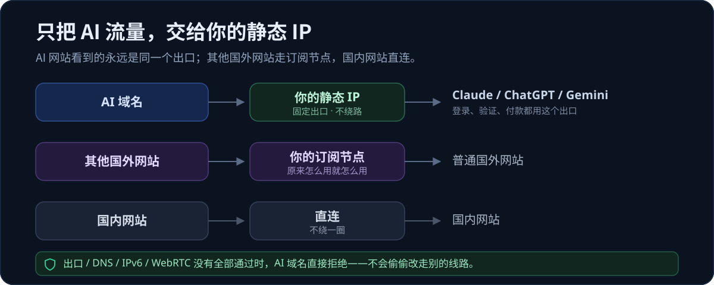
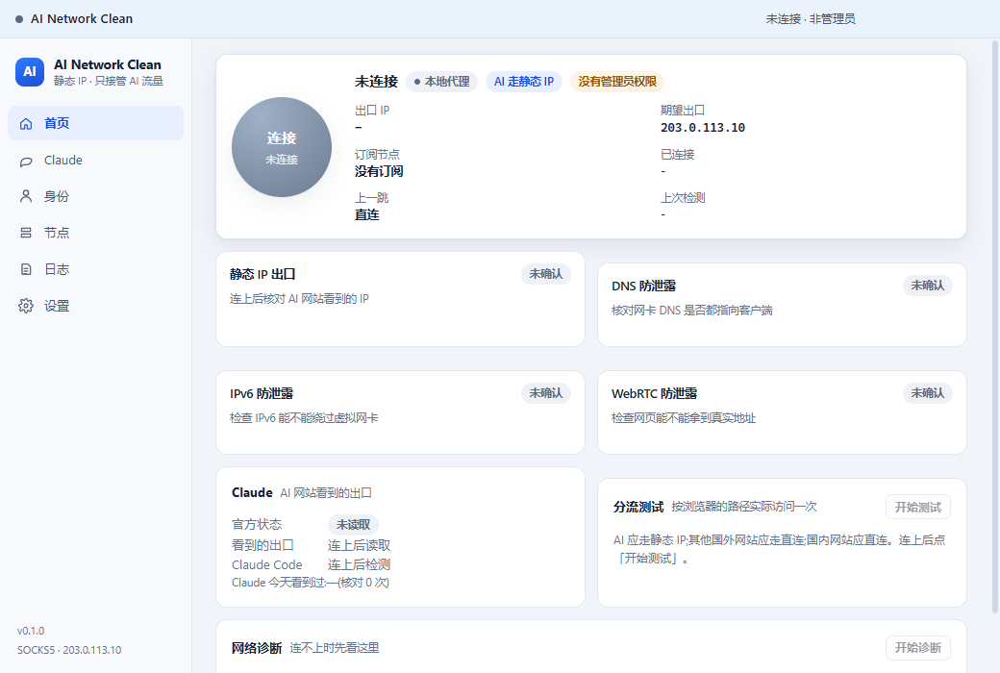
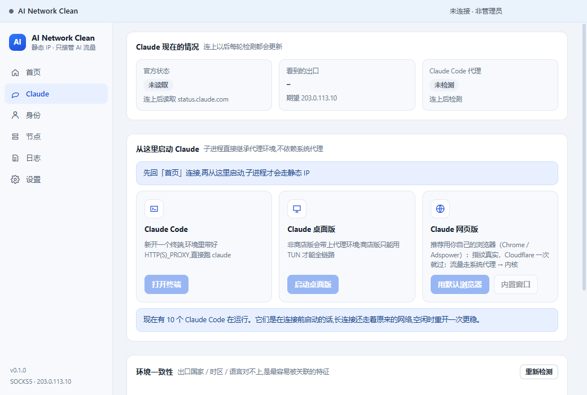
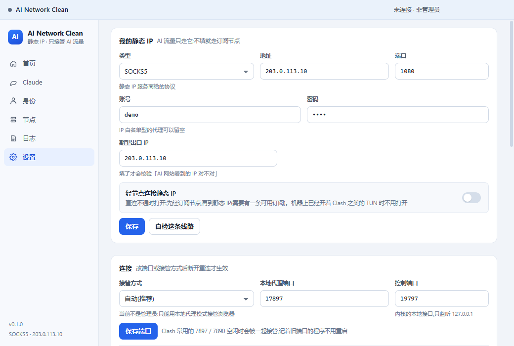

<p align="center">
  
</p>

# AI Network Clean

**一句话：把你自己的静态 IP 和 Clash 订阅，变成一个“只给 AI 网站用”的分流通道。**

<p>
  
  
  
  
  
</p>

> 这不是加速器，也不卖线路。它只做一件事：**让 AI 网站永远看到同一个出口**，同时不打扰你其他上网流量。

如果你在用 Claude / ChatGPT / Gemini 的订阅，又自己买了“独享静态 ISP IP”，大概遇到过这些事：

- 浏览器挂了代理，但 AI 网站的登录、人机验证、付款走了另一个出口，于是一直被风控；
- 代理软件一开全局，其他网站变慢，国内网站也跟着绕一圈；
- 想开小号，结果 `~/.claude` 和桌面版数据全混在一起；
- 根本不知道 AI 网站到底看到了哪个 IP。

这个客户端把这几件事串成一条链：**只拦 AI 域名 → 固定走你的静态 IP → 四项防护全绿才放行 → 其他流量原样不动。**

---

## 它到底怎么走流量

看开头的图就够了，三句话：

| 你要访问的 | 走哪 | 结果 |
|---|---|---|
| AI 域名（Claude / ChatGPT / Gemini 及其登录、验证、付款域名） | 你填的静态 IP | 出口永远一致 |
| 其他国外网站 | 你自己的 Clash 订阅节点 | 和平时一样 |
| 国内网站 | 直连 | 不绕路 |

关键点：**AI 相关的所有域名都走同一个出口，包括 Cloudflare 挑战页从 `*.challenges.cloudflare.com` 子域名加载的脚本。** 这一点没做对，就会无限跳 CF 验证——本工程已经踩过并修好了（见 [docs/VERIFICATION.md](docs/VERIFICATION.md) §2.9）。

---

## 功能

**分流**
- 只接管 AI 域名，其他网站不经过它；国内直连
- 兼容 Clash 常用的 `7897 / 7890` 端口：记着旧端口的程序不用重启
- 有管理员权限用虚拟网卡（TUN）接管全部程序；没有就自动退回系统代理模式

**防封（核心）**
- **AI 闸门**：出口 IP / DNS / IPv6 / WebRTC 四项防护没有全部通过时，AI 域名直接拒绝，绝不悄悄改走别的线路
- **逐连接检查**：每 2 秒读一次内核连接表，发现 AI 连接没走静态 IP 就立刻关闸并通知
- **DNS 接管 + 看守进程**：物理网卡的 DNS 临时指向内核，查询只能进 TUN；客户端被强杀也会自动改回去
- **出口一致性**：登录、验证、付款、挑战脚本全部走同一个静态 IP
- **身份隔离**：每个账号一套独立的 `.claude` / `.claude.json` / 桌面版数据，同盘改名切换，可回滚
- **环境一致性核验**：出口国家 vs 时区 / 语言 / 平台，对不上就明确告诉你哪里矛盾
- **本地残留清理**：会话 / 缓存 / 登录痕迹分组扫描，先备份再删，只动白名单路径

**Claude 相关**
- Claude 官方状态、AI 网站看到的出口、连接前就开着的 Claude 提示
- Claude Code 代理检测与一键修正（连上改、断开还原，改前备份）
- 从客户端直接启动 Claude Code / 桌面版 / 网页版，子进程继承代理环境，不靠系统代理

**日常使用**
- 断线自动重连；系统代理接管与精确还原（含 PAC）
- 设置自动备份（保留 5 份，可一键恢复）
- 日志搜索、分流测试、一键诊断报告（自动脱敏）

---

## 界面

<p align="center">
  
  
</p>
<p align="center">
  
</p>

> 截图用的是示例配置（`203.0.113.10` 是文档专用地址），不代表真实线路。

---

## 快速开始

### 方式一：下载安装包

到 [Releases](https://github.com/kael-odin/ai-network-clean/releases/latest) 下载 `AI-Network-Clean-Setup-0.1.0.exe`，双击安装（按用户安装，不需要管理员装）。

第一次启动会弹 UAC：**同意**才有虚拟网卡模式；不同意也能用，只是只能接管浏览器。

### 方式二：自己构建

需要 Node.js ≥ 24、Windows。

```bash
git clone https://github.com/kael-odin/ai-network-clean.git
cd ai-network-clean
npm install

# 下载 mihomo 内核 + 地理数据库(不打进仓库,约 90MB)
npm -w ain-clean run resources

npm -w ain-clean run build      # 主进程 / 预加载 / 界面
npm -w ain-clean run dist:win   # 打 NSIS 安装包(需要 Electron 运行时,见下)
```

没有 Electron 运行时的话，打包时指定一份解压好的：

```bash
npx electron-builder --win nsis --x64 \
  -c.electronDist=<解压后的 electron 目录> -c.electronVersion=44.8.0
```

### 第一次使用

1. 打开客户端，首页点「连接」前先把两件事填好；
2. 「设置 → 我的静态 IP」填服务商给的 **类型 / 地址 / 端口 / 账号 / 密码 / 期望出口 IP**；
3. 「节点 → 节点订阅」粘一条你自己的 Clash 订阅（可选，但“经节点连接静态 IP”时必须有）；
4. 看你的机器上有没有 Clash 之类的 TUN（见下面两种拓扑）；
5. 回到首页点「连接」，等四项防护变绿，AI 才会放行；
6. 去「Claude」页，用「用默认浏览器」打开 Claude 网页，或从那里启动 Claude Code / 桌面版。

> 数据目录：`%APPDATA%\ain-clean`。设置是明文 JSON（含订阅令牌和静态 IP 密码），和 Clash 存订阅的做法一致，**不要把这个文件发给别人**。

---

## 两种常见拓扑（按你的网络选）

**A. 机器上已经开着 Clash Verge 之类的 TUN**

静态 IP **不用**勾「经节点连接」——中转交给 Clash，本客户端只负责把 AI 流量送到静态 IP。

**B. 机器上没有 TUN**

勾上「经节点连接静态 IP」，并在「节点」页固定一个**能到达静态 IP 服务商**的节点。
静态 IP 供应商通常是按来源 IP 放行的：家宽、部分机房 IP 会被拒绝，换一个节点往往就能通。本工程实测过“同一供应商、不同节点，有的通有的不通”。

> 不知道选哪个：先按 A 试；A 连不上静态 IP 再试 B。
> 两种拓扑下，AI 网站看到的都是同一个静态 IP，中转是谁不影响身份一致性。

---

## 常见问题

**Q：一打开 Claude 就一直跳 Cloudflare 验证？**
A：先确认用的是「用默认浏览器」，不是内置窗口。挑战脚本从 `*.challenges.cloudflare.com` 子域名加载，必须和主页面走同一个出口——本工程已在规则里强制后缀匹配。Electron 内置窗口即使伪装 UA 也可能被持续挑战，所以推荐真实浏览器。

**Q：为什么每次启动都弹 UAC？**
A：安装包清单是 `highestAvailable`（和官方客户端一致），TUN 需要管理员。如果你只想用本地代理模式，可以在设置里把接管方式改成「本地代理」，但每次启动仍会请求提权；不同意就退出，不会静默降权运行。

**Q：静态 IP 连不上，供应商说 IP 被禁？**
A：先看「设置 → 自检这条线路」里的原始回复。常见三种：认证失败（账号密码错）、IP 不在白名单（找供应商加白）、来源 IP 被封（换节点）。完整排查记录在 [docs/STATIC-IP.md](docs/STATIC-IP.md)（IP 已替换成示例地址）。

**Q：多账号怎么隔离？**
A：「身份」页把当前这套 `~/.claude` + `~/.claude.json` + `%APPDATA%\Claude` 归档成一个身份，再登录新号；切换时同盘改名，不复制、不压缩。Claude 在跑时会拒绝操作，避免文件混在一起。

**Q：它会不会偷偷上传数据？**
A：没有账号、没有注册、没有遥测、没有自动更新。唯一的外部请求是：内核拉你自己的订阅、读 Claude 官方状态、以及出口核对。

---

## 它是怎么实现的

- **Electron 44** 主进程 + React 界面，内核用 [mihomo](https://github.com/Metacubex/mihomo)（Clash Meta）
- 规则只对 AI 域名做特殊处理，其余走 `MATCH`（订阅节点）和国内直连
- AI 域名前面挂一个「AI 放行」选择组：闸门关闭时指向 `REJECT`，四项防护全绿才切到「静态 IP」
- TUN 模式用 `auto-route` + `dns-hijack any:53` + fake-ip；物理网卡 DNS 由客户端临时改写，退出/被强杀由看守进程还原
- 本地代理模式接管系统代理（同时清掉 PAC，避免 PAC 抢流量），断开时按备份精确还原
- 身份隔离用同盘 `rename`，目标存在则合并搬入、绝不覆盖；每个身份带 `meta.json`，真实数据里留 `.identity` 标记，状态文件丢了也能认回来

更细的模块与数据流见 [docs/ARCHITECTURE.md](docs/ARCHITECTURE.md)。

---

## 开发与目录

```bash
npm -w ain-clean run typecheck   # tsc
npm -w ain-clean run build       # esbuild
npm -w ain-clean run resources   # 下载内核与地理数据库
node apps/desktop/scripts/check-config.mjs     # 28 项配置断言(离线)
node apps/desktop/scripts/test-identities.mjs  # 身份隔离 7 组测试(离线,不碰真实 ~/.claude)
```

```
apps/desktop
├─ src/main/          主进程:内核管理、闸门、防护、DNS、Claude、身份
├─ src/preload/       contextBridge 白名单
├─ src/renderer/      React 界面(首页 / Claude / 身份 / 节点 / 日志 / 设置)
├─ src/shared/ipc.ts  三方共用的类型与 IPC 契约
├─ scripts/           esbuild、图标、资源下载、自检
└─ resources/         内核与地理数据库(自行下载,不入库)
packages/rules        分流规则模板
tools/                测试脚本(本地 SOCKS5 替身、CDP 驱动、TUN 实测)
docs/                 架构、验收记录、静态 IP 排查
```

验收记录（TUN / 本地代理 / 身份隔离 / Cloudflare 修复）都在 [docs/VERIFICATION.md](docs/VERIFICATION.md)，里面的 IP 已统一替换为示例地址。

---

## 边界与免责声明

- **不提供**静态 IP、订阅、账号或任何线路；这些都要你自己有。
- **不保证**不被封。风控是对方决定的，这个工具只负责把“出口一致、环境一致、不泄露”做到位。
- **只支持 Windows**；安装包未签名，SmartScreen 可能提示。
- 主进程源码来自官方 `AI-Network-Setup-0.1.23.exe` 内 `app.asar` 的 source map（`sourcesContent`），属于**还原**而非原创；界面为本工程重写。仅供个人学习研究，请勿商用，与原厂无关。
- 运行时不打包 mihomo：它按 GPL-3.0 单独分发，构建时从上游下载。地理数据库来自 [meta-rules-dat](https://github.com/MetaCubeX/meta-rules-dat)。
- 使用本工具产生的任何后果由使用者自行承担；请遵守你所在地区法律和所用服务的条款。

---

<p align="center">
  <sub>如果这个项目帮你把出口理顺了，点个 Star 就行；不接受捐赠，也不卖任何东西。</sub>
</p>
